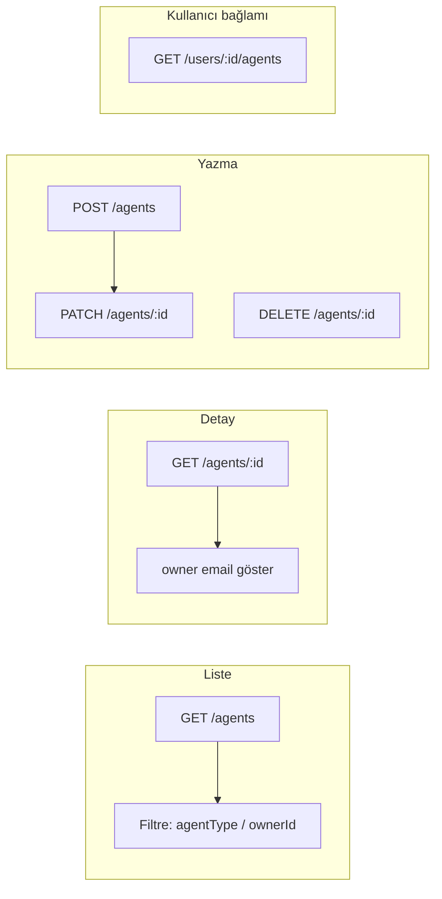

# Friendfy — App Panel Agent API (v2)

Bu belge **yönetim paneli AI** için Friendfy agent (bot) entegrasyonunu açıklar. Kullanıcı API’si ile aynı base URL ve API key kullanılır; mobil `/agent/*` rotalarına dokunulmaz.

---

## Bağlantı bilgileri

| Ayar | Değer |
|------|--------|
| Base URL | `https://friendfy.fly-work.com/panel/v1` |
| Auth header | `x-panel-api-key: <PANEL_API_KEY>` |
| Content-Type | `application/json` |

Genel kullanıcı + sağlık uçları: [`PANEL_INTEGRATION_FRIENDIFY.md`](./PANEL_INTEGRATION_FRIENDIFY.md)

---

## Agent türleri (`system`)

| `agentType` | `system` | Açıklama | Sahip (`owner`) |
|-------------|----------|----------|-----------------|
| `custom` | `0` | Kullanıcının oluşturduğu agent | `users.id` = `creatorId` (zorunlu) |
| `catalog` | `1` | Uygulama kataloğu (sistem) | Genelde `creatorId = 0` → panelde "Sistem / katalog" |
| `template` | `2` | Şablon / import karakterleri | Genelde sistem |

Mobil uygulama katalog düzenlemesinde `bot_catalog_overrides` kullanır; **panel doğrudan `bots` satırını** günceller (admin yetkisi).

---

## Endpoint özeti

| Endpoint | Metot | Amaç |
|----------|-------|------|
| `/agents` | GET | Tüm agentlar (sayfalı, filtreli) |
| `/agents` | POST | Yeni agent oluştur |
| `/agents/:id` | GET | Tek agent + sahip bilgisi |
| `/agents/:id` | PATCH | Agent güncelle |
| `/agents/:id` | DELETE | Agent sil |
| `/users/:id/agents` | GET | Belirli kullanıcının agentları |
| `/analyse` | GET | `agentsSummary` dahil özet metrikler |

Panelde kayıt örneği (Users’a ek):

- Agents list: `https://friendfy.fly-work.com/panel/v1/agents`

---

## PanelAgent şeması

```json
{
  "id": "128",
  "name": "Ayşe",
  "agentType": "custom",
  "system": 0,
  "status": "active",
  "owner": {
    "id": "42",
    "email": "user@example.com",
    "displayName": "KullanıcıAdı",
    "isSystemOwner": false
  },
  "createdAt": "2026-05-10T08:00:00.000Z",
  "extras": {
    "character": "...",
    "age": 24,
    "gender": "female",
    "country": "tr",
    "voiceId": "elevenlabs-voice-id",
    "speakingStyle": "...",
    "exampleResponse": "...",
    "riveAvatar": "https://cdn.../avatar.riv",
    "photoURLs": ["https://..."],
    "photoURL": "https://...",
    "interests": ["müzik", "seyahat"],
    "interestsType": [],
    "characterTags": [],
    "userAgentOrigin": "friend_create",
    "creatorId": "42"
  }
}
```

Katalog agent örneği (`owner.isSystemOwner: true`, `owner.id: null`).

---

## GET /agents

**Query parametreleri**

| Param | Açıklama |
|-------|----------|
| `page` | Sayfa (varsayılan 1) |
| `limit` | Sayfa boyutu (max 100) |
| `search` | `name`, `character`, `id` içinde arama |
| `system` | `0`, `1`, `2` |
| `agentType` | `custom`, `catalog`, `template` (`system` ile aynı) |
| `ownerId` / `creatorId` | Sahip kullanıcı id |

**200**

```json
{
  "contractVersion": "2",
  "agents": [ /* PanelAgent[] */ ],
  "pagination": { "page": 1, "limit": 20, "total": 350, "totalPages": 18 }
}
```

---

## POST /agents — Oluşturma

İki mod desteklenir:

1. **`application/json`** — `photoURLs` ve `riveAvatar` hazır CDN URL olarak
2. **`multipart/form-data`** — 3 foto + `.riv` dosyası sunucuya yüklenir (Bunny CDN)

### Multipart ile dosya yükleme (önerilen)

**Content-Type:** `multipart/form-data`  
**Auth:** `x-panel-api-key` (header)

| Alan (form) | Tip | Açıklama |
|-------------|-----|----------|
| `photo1` | dosya | 1. foto (jpeg/png/webp, max 8 MB) |
| `photo2` | dosya | 2. foto |
| `photo3` | dosya | 3. foto |
| `photos[]` | dosya | Alternatif: en fazla 3 foto tek alanda |
| `riveFile` | dosya | `.riv` animasyon (max 25 MB) |
| `name` | metin | Zorunlu |
| `agentType` | metin | `catalog` / `template` / `custom` |
| `voiceId` | metin | Zorunlu |
| `character`, `age`, `gender`, … | metin | Diğer alanlar |
| `interests` | metin | JSON dizi string olabilir: `["a","b"]` |

**Katalog / şablon (`agentType=catalog` veya `template`) dosya ile oluştururken:**

- Tam **3 foto** zorunlu (`photo1` + `photo2` + `photo3`)
- **riveFile** zorunlu

Dosyalar `panel-agents/{slug}/photo-1.jpg` … ve `avatar.riv` olarak Bunny’e yüklenir; DB’ye public URL yazılır (`https://fakefriend.b-cdn.net/...`).

**Custom agent:** 1–3 foto ve Rive opsiyonel (URL veya dosya).

### JSON ile (URL hazırsa)

### Katalog agent (panelden yeni karakter)

```json
{
  "name": "Zeynep",
  "agentType": "catalog",
  "voiceId": "EXAVITQu4vr4xnSDxMaL",
  "character": "Sıcak ve samimi...",
  "age": 22,
  "gender": "female",
  "country": "tr",
  "speakingStyle": "Doğal ve akıcı",
  "photoURLs": [
    "https://fakefriend.b-cdn.net/.../photo-1.jpg",
    "https://fakefriend.b-cdn.net/.../photo-2.jpg",
    "https://fakefriend.b-cdn.net/.../photo-3.jpg"
  ],
  "riveAvatar": "https://fakefriend.b-cdn.net/.../avatar.riv",
  "interests": ["kitap", "kahve"],
  "characterTags": ["friendly"]
}
```

`ownerId` gerekmez; `creatorId` otomatik `0`.

### Kullanıcı agent (custom)

```json
{
  "name": "Benim Botum",
  "agentType": "custom",
  "ownerId": "42",
  "voiceId": "EXAVITQu4vr4xnSDxMaL",
  "character": "Yardımsever asistan"
}
```

**Zorunlu:** `name`, `voiceId`, `ownerId` (custom için).

**201** — `{ "contractVersion": "2", "ok": true, "agent": PanelAgent }`

---

## PATCH /agents/:id

JSON veya **multipart/form-data** (POST ile aynı dosya alanları). Katalog agent’ta foto güncellerken yine **3 foto birlikte** gönderin.

Kısmi güncelleme. Üst seviye veya `extras` altından alan gönderilebilir:

- `name`, `character`, `age`, `gender`, `country`, `voiceId`, `speakingStyle`, `exampleResponse`
- `rive_avatar` / `riveAvatar`
- `photoURL` / `photoURLs`
- `interests`, `interestsType`, `characterTags`
- `ownerId` / `creatorId` (sahibi taşıma)
- `agentType` / `system`

**200** — güncel `agent`

---

## DELETE /agents/:id

**200** — `{ "ok": true, "deletedId": "128" }`

> İlişkili `coversations` / `messages` kayıtları otomatik silinmez. Gerekirse önce panelden konuşmaları temizleyin veya DB bakımı yapın.

---

## GET /users/:id/agents

Belirli kullanıcının `system = 0` ve `creatorId = :id` agentlarını listeler (sayfalı).

---

## GET /analyse — Agent metrikleri

Yanıtta ek alan:

```json
{
  "agentsSummary": {
    "totalAgents": 420,
    "newAgentsToday": 3,
    "withUserOwner": 85,
    "byType": {
      "custom": 85,
      "catalog": 200,
      "template": 135,
      "unknown": 0
    }
  }
}
```

`newAgentsToday` yalnızca `bots.created_at` kolonu varsa dolu.

---

## Panel AI iş akışı



1. Dashboard: `GET /analyse` → `agentsSummary.totalAgents`, `byType`.
2. Agent listesi: `GET /agents?agentType=catalog&page=1`.
3. Kullanıcı detayından agentlar: `GET /users/42/agents`.
4. Yeni katalog karakteri: `POST /agents` + `agentType: catalog`.
5. Düzenle: `PATCH /agents/:id`.
6. Kaldır: `DELETE /agents/:id`.

---

## Örnek curl

```bash
export BASE="https://friendfy.fly-work.com/panel/v1"
export KEY="your-panel-api-key"

curl -s -H "x-panel-api-key: $KEY" "$BASE/agents?agentType=catalog&limit=10"

curl -s -H "x-panel-api-key: $KEY" "$BASE/agents/128"

curl -s -H "x-panel-api-key: $KEY" "$BASE/users/42/agents"

curl -s -X POST -H "x-panel-api-key: $KEY" \
  -F "name=Zeynep" \
  -F "agentType=catalog" \
  -F "voiceId=EXAVITQu4vr4xnSDxMaL" \
  -F "character=Sicak ve samimi" \
  -F "photo1=@/path/photo1.jpg" \
  -F "photo2=@/path/photo2.jpg" \
  -F "photo3=@/path/photo3.jpg" \
  -F "riveFile=@/path/avatar.riv" \
  "$BASE/agents"

curl -s -X POST -H "x-panel-api-key: $KEY" -H "Content-Type: application/json" \
  -d '{"name":"Test","agentType":"catalog","voiceId":"voice123","character":"..."}' \
  "$BASE/agents"

curl -s -X PATCH -H "x-panel-api-key: $KEY" -H "Content-Type: application/json" \
  -d '{"name":"Yeni İsim"}' \
  "$BASE/agents/128"

curl -s -X DELETE -H "x-panel-api-key: $KEY" "$BASE/agents/128"
```

---

## Mobil API ile farklar (önemli)

| Konu | Mobil (`/agent/*`) | Panel (`/panel/v1/agents`) |
|------|-------------------|----------------------------|
| Auth | JWT `x-auth-token` | `x-panel-api-key` |
| Katalog düzenleme | `bot_catalog_overrides` | Doğrudan `bots` |
| Oluşturma | Yalnızca kendi `ownerId` | Herhangi `ownerId` / katalog |
| Silme | Yalnızca kendi `system=0` | Herhangi agent |

Bu ayrım sayesinde uygulama akışları bozulmaz.

---

## Kod referansı (repo)

| Dosya | Rol |
|-------|-----|
| `routes/panel.js` | HTTP uçları |
| `routes/lib/panelAgentMapper.js` | PanelAgent ↔ DB |
| `routes/lib/panelAgentService.js` | Sorgular, CRUD |
| `routes/lib/panelAgentUploads.js` | Foto / Rive → Bunny CDN |
| `middleware/panelAgentUpload.js` | Multer (multipart) |
| `lib/bunnyStorage.js` | CDN upload |
| `routes/agents.js` | Mobil agent API (değiştirilmedi) |

---

## Panel AI’ya verilecek kısa prompt

```text
Friendfy panel agent API hazır. Base: https://friendfy.fly-work.com/panel/v1
Auth: x-panel-api-key
Agent list/create/read/update/delete: /agents, /agents/:id
Kullanıcının agentları: GET /users/:userId/agents
agentType: custom(0), catalog(1), template(2). owner alanı JOIN ile users tablosundan.
POST catalog: name + voiceId + character... ownerId yok.
Multipart catalog: photo1+photo2+photo3 + riveFile zorunlu (CDN otomatik).
POST custom: name + voiceId + ownerId zorunlu.
PATCH her türde bots tablosunu günceller (mobil override değil).
Tam şema: docs/PANEL_AGENTS_API.md
```
