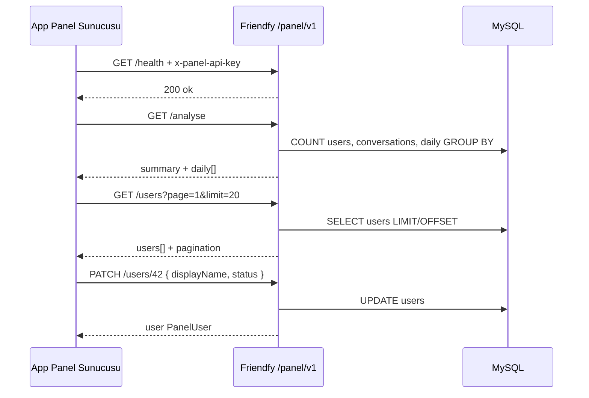

# Friendfy — Yönetim paneli entegrasyon rehberi

Bu belge, **App Panel** (dış yönetim paneli) ile **Friendfy mobil API** (`friendfyapis`) arasındaki entegrasyonu özetler. Paneli geliştiren yapay zekâ veya ekip için tek referans noktasıdır.

---

## 1. Ne yapıldı?

Mobil uygulama rotaları (`/auth`, `/agent`, `/chat`, …) **değiştirilmedi**. Panel için ayrı bir API yüzeyi eklendi:

| Özellik | Değer |
|---------|--------|
| Mount | `app.js` → `app.use('/panel/v1', panel)` |
| Kod | `routes/panel.js`, `middleware/panelAuth.js`, `routes/lib/panelUserMapper.js`, `routes/lib/panelAnalytics.js`, `routes/lib/panelAgentMapper.js`, `routes/lib/panelAgentService.js` |
| Sözleşme | App Panel **v2** (`INTEGRATION_TEMPLATE.md`) |
| Detaylı JSON | `docs/EXTERNAL_API_CONTRACT.md` |
| Agent API | `docs/PANEL_AGENTS_API.md` |

---

## 2. Base URL (panel ayarlarında kaydedilecek)

Üretim (mobil uygulama ile aynı host):

```text
https://friendfy.fly-work.com/panel/v1
```

Yerel geliştirme:

```text
http://localhost:3000/panel/v1
```

Panel arayüzünde genelde **üç tam URL** kaydedilir:

| Amaç | Tam URL |
|------|---------|
| Health | `https://friendfy.fly-work.com/panel/v1/health` |
| Analyse | `https://friendfy.fly-work.com/panel/v1/analyse` |
| Users (liste + PATCH base) | `https://friendfy.fly-work.com/panel/v1/users` |
| Agents (liste + CRUD base) | `https://friendfy.fly-work.com/panel/v1/agents` |

Tek kullanıcı: `GET/PATCH .../panel/v1/users/{id}`  
Kullanıcının agentları: `GET .../panel/v1/users/{id}/agents`  
Tek agent: `GET/PATCH/DELETE .../panel/v1/agents/{id}`

> **Not:** Mobil `AppConstants.baseURL` (`https://friendfy.fly-work.com`) kök dizindir; panel **`/panel/v1`** suffix kullanır. Karıştırmayın.

---

## 3. Güvenlik

1. Sunucu `.env` içine güçlü bir anahtar: `PANEL_API_KEY=...`
2. Panel backend'i her istekte header gönderir:

```http
x-panel-api-key: <PANEL_API_KEY ile aynı değer>
Content-Type: application/json
```

3. Anahtar yoksa API **503** döner; uçlar açık kalmaz.
4. Panel şu an `Authorization: Bearer` göndermiyor; JWT mobil akış içindir.
5. İsteğe bağlı: reverse proxy / firewall ile panel sunucusu IP’sini kısıtlayın.

---

## 4. Veri kaynağı (Friendfy MySQL)

Ana tablo: `` `users` ``

| Panel alanı | Kaynak |
|-------------|--------|
| `id` | `users.id` (string) |
| `email` | `users.email` |
| `displayName` | `users.username` |
| `phone` | `users.phoneNumber` |
| `status` | `users.verificated` → active(1), inactive(0), banned(2) |
| `createdAt` | `users.accountCreatedDate` |
| `lastLoginAt` | `users.lastLogins` JSON/dizi içinden en son tarih (çoğu kullanıcıda boş olabilir) |
| `extras.credential` | `users.credential` (email, google, apple, guest) |
| `extras.isGuest` | email `@guest.local` veya `guest_` prefix |
| `extras.membershipsSummary` | `users.memberships` parse özeti |

### Metrikler (`/analyse`)

| Panel alanı | Friendfy hesaplama |
|-------------|-------------------|
| `summary.totalUsers` | `COUNT(*)` FROM `users` |
| `summary.newUsersToday` | `accountCreatedDate` bugün (İstanbul TZ, UTC+3) |
| `summary.loginsToday` | Bugün `coversations` tablosunda aktivitesi olan **benzersiz** `userId` (`last_message_at` veya `started_at`) |
| `daily[].newUsers` | Gün bazlı yeni kayıt |
| `daily[].logins` | Gün bazlı sohbet aktivitesi (aynı mantık) |

**Önemli:** Gerçek “oturum açma” event tablosu yok; `loginsToday` / `daily.logins` pratikte **günlük aktif kullanıcı (sohbet)** metrikidir. Panel UI’da bunu “Giriş / Aktivite” olarak etiketlemek doğru olur. İleride `lastLogins` istemcide doldurulursa `lastLoginAt` alanı zenginleşir; özet metrikler şimdilik sohbet tabanlıdır.

---

## 5. PATCH davranışı

- Sadece gönderilen alanlar güncellenir.
- `extras` altında yalnızca `gender`, `country`, `photoURL`, `hobbies` yazılır.
- `memberships`, `credential`, token alanları panel PATCH ile **değiştirilmez** (mobil / satın alma akışı bozulmasın diye).
- Email çakışmasında **409** `EMAIL_IN_USE`.

---

## 6. Panel AI için iş akışı



1. **Bağlantı testi:** Health URL + API key → 200 ve `"ok": true`.
2. **Dashboard:** Analyse URL → kartlarda `totalUsers`, `loginsToday`, `newUsersToday`; grafikte `daily`.
3. **Kullanıcı listesi:** Users URL + sayfalama; arama için `?search=mail`.
4. **Düzenleme:** `PATCH {base}/users/{id}` — gövdede kanonik alanlar (`displayName`, `email`, `phone`, `status`, `extras`).

---

## 7. Örnek curl

```bash
export PANEL_BASE="https://friendfy.fly-work.com/panel/v1"
export PANEL_API_KEY="your-secret"

curl -s -H "x-panel-api-key: $PANEL_API_KEY" "$PANEL_BASE/health"

curl -s -H "x-panel-api-key: $PANEL_API_KEY" "$PANEL_BASE/analyse"

curl -s -H "x-panel-api-key: $PANEL_API_KEY" "$PANEL_BASE/users?page=1&limit=10"

curl -s -X PATCH -H "x-panel-api-key: $PANEL_API_KEY" \
  -H "Content-Type: application/json" \
  -d '{"displayName":"Yeni Ad","status":"active"}' \
  "$PANEL_BASE/users/42"
```

---

## 8. Deploy kontrol listesi

- [ ] `PANEL_API_KEY` üretim `.env` dosyasında tanımlı
- [ ] Panel sunucusuna aynı key verildi
- [ ] Panelde üç URL (`health`, `analyse`, `users`) `/panel/v1` ile kayıtlı
- [ ] HTTPS aktif
- [ ] `/auth/*`, `/agent/*` rotalarına dokunulmadı (mobil regression yok)

---

## 9. İlgili dosyalar (repo)

| Dosya | Rol |
|-------|-----|
| `INTEGRATION_TEMPLATE.md` | Genel App Panel v2 şablonu |
| `docs/EXTERNAL_API_CONTRACT.md` | JSON alan sözleşmesi |
| `routes/panel.js` | Route handler'lar |
| `middleware/panelAuth.js` | API key |
| `routes/lib/panelUserMapper.js` | DB ↔ PanelUser |
| `routes/lib/panelAnalytics.js` | `/analyse` sorguları |
| `.env.example` | `PANEL_API_KEY`, `PANEL_ANALYTICS_DAYS` |

---

## 10. Agent (bot) yönetimi

Tüm agent uçları **`/panel/v1/agents`** altında; mobil `/agent/*` JWT rotaları aynen durur.

| İşlem | Endpoint |
|--------|----------|
| Liste (sahip + tür filtreli) | `GET /agents?agentType=&ownerId=&search=` |
| Oluştur | `POST /agents` (**multipart**: 3 foto + `.riv` → API Bunny’ye yükler) |
| Detay | `GET /agents/:id` |
| Güncelle | `PATCH /agents/:id` |
| Sil | `DELETE /agents/:id` |
| Kullanıcıya göre | `GET /users/:id/agents` |

`GET /analyse` yanıtında `agentsSummary` (toplam, türe göre, bugün yeni).

**Tam agent dokümantasyonu (panel AI için):** [`docs/PANEL_AGENTS_API.md`](./PANEL_AGENTS_API.md)

**Karakter medya kuralı:** Her yeni karakterde tam **3 fotoğraf** + **1 Rive (.riv)**; panel dosyayı CDN’e kendisi yüklemez, `POST /panel/v1/agents` multipart ile Friendfy API Bunny’ye yükler.

---

## 11. Panel AI'ya verilecek kısa prompt

```text
Friendfy backend App Panel v2 entegrasyonu hazır.
Base URL: https://friendfy.fly-work.com/panel/v1
Auth: header x-panel-api-key = ortam değişkenindeki PANEL_API_KEY
Health: GET /health
Analyse: GET /analyse → summary + agentsSummary + daily[]
Users: GET /users?page=&limit=&search= | PATCH /users/:id
Agents: GET/POST /agents | GET/PATCH/DELETE /agents/:id | GET /users/:id/agents
Karakter EKLE: multipart only — photo1, photo2, photo3, riveFile (API → Bunny CDN). Her karakter 3 foto + 1 riv zorunlu.
agentType: custom(0), catalog(1), template(2); owner JOIN users
Kullanıcı JSON: docs/EXTERNAL_API_CONTRACT.md
Agent JSON: docs/PANEL_AGENTS_API.md
Genel işleyiş: docs/PANEL_INTEGRATION_FRIENDIFY.md
Mobil API kökü /auth, /agent vb.; panel yalnızca /panel/v1 kullanır.
```
